## 1. Architecture and shared state

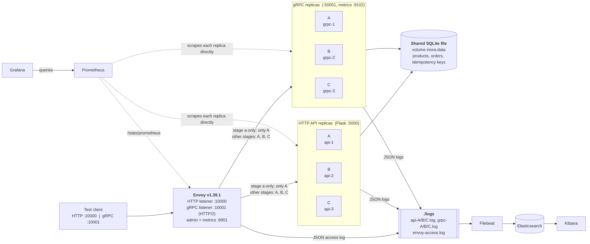{width=88%}

The HTTP API and the gRPC service each run as three copies (A, B, C = containers 1, 2, 3, created with Docker Compose
scaling). Envoy v1.39.1 is the only entry point. Its gRPC listener is an HTTP/2-aware connection manager, so it sees
every call and routes it separately; a plain TCP proxy would pin one connection (and so all calls) to one replica.
Test traffic is read-only: `GET /products/{id}` and unary `inora.v1.CatalogService/GetProduct`. Each replica writes its
letter into its logs, the `X-Replica` header / gRPC `x-replica` metadata and a `replica` metric label, and keeps the
W3C `traceparent` from request to log line.

| State | Shared or per replica | What it means with several replicas |
|---|---|---|
| Products, stock, orders | **Shared**: one SQLite file on a Docker volume | Correct. Writes run in `BEGIN IMMEDIATE`; stock cannot go negative (`WHERE stock >= quantity` and `CHECK (stock >= 0)`). SQLite allows one writer at a time, so concurrent writes queue; our test traffic is read-only. |
| Idempotency records | **Shared**: table in the same file, written in the same transaction as the order | Duplicate prevention works across replicas and across HTTP and gRPC. Checked: the same key sent to B (creates), then C and A (replay) gave one order. |
| Rate-limit counters (5 `POST /orders` per 10 s per client address) | **Per replica**: a Python dict in each HTTP process; gRPC has no limit | Breaks the limit. Measured: A only, 5 accepted and 10 rejected of 15; round robin, 15 accepted, 5 on each replica, none rejected. The effective limit is 5 x the number of replicas, and counters vanish on restart. Fix: a shared counter store, or enforce the limit in Envoy. |
| Metrics, log files, replica id | **Per replica**, by design | The `replica` label/field makes them comparable and addable. |

## 2. Health-check settings, retries and circuit breakers

Experiment 3 uses active health checks (`envoy/stages/health-check.yaml`); no other experiment has health checks.

| | HTTP cluster | gRPC cluster |
|---|---|---|
| Check | `GET /health` (answers 200, not counted in metrics) | TCP connect to port 50051 |
| Interval / timeout | 2 s / 1 s | 2 s / 1 s |
| Failures to mark unhealthy / passes to mark healthy | 2 / 2 | 2 / 2 |
| No-traffic interval | 2 s | 2 s |
| DNS refresh | 600 s | 600 s |

DNS refresh is slowed from 5 s to 600 s in this stage on purpose: otherwise Docker stops resolving a stopped container's name
and Envoy would drop B because of DNS, not because of the health check. B kept its address after the restart,
so this did not matter. No retries are configured anywhere (no `retry_policy`, no client retries) and the circuit-breaker
limits are set to 1,000,000 so they can never trigger.

## 3. Metrics, queries and the test client

Prometheus scrapes A, B, C (HTTP on port 5000, gRPC metrics on 9102) and Envoy (`envoy:9901`) every 5 s, directly, never
through the balanced route (Figure 18). Every rate and percentile uses a **30 s window** (6 scrapes), and the dashboard time range is
set to each run. Per replica and per interface (the gRPC queries use `grpc_server_handled_total`,
`grpc_server_in_flight` and `grpc_server_handling_seconds_bucket` in the same way):

* rate: `sum by (replica) (rate(app_requests_total{endpoint="/products/<product_id>"}[30s]))`
* share: `100 * that / scalar(sum(rate(app_requests_total{endpoint="/products/<product_id>"}[30s])))`
* active requests: `sum by (replica) (app_active_requests)`
* p50 / p95: `histogram_quantile(0.5 | 0.95, sum by (le, replica) (rate(app_request_latency_seconds_bucket{...}[30s])))`
* errors by status: `sum by (replica, http_status) (rate(app_requests_total{http_status!~"2.."}[30s]))`

A fourth row shows Envoy's view: requests per cluster, responses by class (2xx/5xx), healthy members, requests in flight.
Labels are replica, route template (`/products/<product_id>`) and status only; product ids and trace ids are never labels
(trace ids are only in logs). Two limits of these charts: p50/p95 come from histogram buckets (boundaries at 0.25 s and
0.5 s), so a true 400 ms delay is drawn as about 375 ms / 488 ms; and the active-requests value is sampled every 5 s, so
it only shows anything when requests are slow (Experiment 2).

**Client** (`scripts/loadgen.py`): open loop, request *i* sent at `t0 + i/rate` without waiting for responses, no
retries, 5 s timeout, one gRPC channel, its own `traceparent` on every request. Every run: **40 requests/s for 60 s =
2400 requests** (failure test: 90 s = 3600). It records requests sent, successes, failures by cause, client p50/p95/p99
(successful requests, measured from the scheduled send time) and which replica answered. **Filebeat is stopped during each
measured run** and started afterwards: on this 4-core laptop log shipping during a run raised the gRPC client p95 from
12 ms to 49-223 ms. Even so, identical runs differ (A-only client p95 was 13-39 ms), so only differences far larger than
that mean anything.

## 4. Baselines (A only, then round robin)

| Run | Sent / OK / failed | Client p95 | A / B / C share (Envoy log) |
|---|---|---|---|
| A only, HTTP | 2400 / 2400 / 0 | 38.9 ms (earlier session: 18.1) | 100 / 0 / 0 % |
| A only, gRPC | 2400 / 2400 / 0 | 32.4 ms (earlier: 13.4) | 100 / 0 / 0 % |
| Round robin, HTTP | 2400 / 2400 / 0 | 31.5 ms (earlier: 17.8) | 33.3 / 33.4 / 33.3 % |
| Round robin, gRPC | 2400 / 2400 / 0 | 31.4 ms (earlier: 12.5) | 33.3 / 33.3 / 33.3 % |

*A only:* A handles everything while B and C are running but idle (Figures 2-3). *Round robin:* every share is within
0.1 percentage points of 33.3 % (Figures 4-5). HTTP is sometimes one request off (799 / 801 / 800) because several
connections are spread over Envoy's worker threads, which probably each keep their own round-robin position; gRPC uses one
connection and came out exactly 800 / 800 / 800 in every equal-weight round-robin run. Compared with A only, A's share fell from 100 % to 33 % and
B's and C's rose from 0 to 33 %. Client p95 did not change (both sessions): at 40 req/s one replica is nowhere near its
limit, so spreading the load does not make requests faster. The first 30 s window of each chart is inflated by new
connections and cold code. The earlier session's numbers (Filebeat stopped, `runs/`) and these (`evidence/`) agree on every
share and every conclusion. These round-robin runs are the baseline for Part D. The measured 15-accepted result of the rate
limiter (Section 1) comes from the same round-robin setup.

## 5. Experiments (HTTP and gRPC separately)

Each starts from round robin, uses the same workload, and was restored afterwards. Charts: Figures 6-15.

**Experiment 1: weighted round robin, A:B:C = 2:1:1.**
*Prediction:* shares 50 / 25 / 25 %; a higher weight sends more requests but adds no capacity, so p95 stays about the same
and active requests stay near 0 (requests last 3-10 ms).
*Observation:* HTTP 1201 / 600 / 599 requests = 50.0 / 25.0 / 25.0 %, client p95 23.2 ms; gRPC 1200 / 600 / 600 = 50 / 25 / 25 %, p95 16.0 ms; no errors. A's rate doubled to about 20 req/s (B and C about 10); active requests stayed 0-1.
*Explanation:* the weights alone decide the shares. The p95 values are lower than in the round-robin runs of the same session (31 ms) but inside the run-to-run noise, and A did not become faster, it just did twice the work. Extra weight only helps when replicas really differ in capacity, and none was near a limit here.

**Experiment 2: +400 ms fixed delay on B, round robin vs least request** (same delay and workload; the delay is read from
`faults/delay.json` by replica B only; Envoy's least request uses its default of two random choices).
*Prediction:* round robin ignores speed, so B keeps 33 %, holds about 13.3 req/s x 0.4 s = 5 requests at once, and about a
third of requests take 400 ms, so client p95 is about 400 ms. Least request sends new work to the replica with fewer active
requests, so B's share drops well below 33 % (my guess 5-11 %) and its active requests drop; p95 improves only if B's share
falls below 5 %.

| | RR, HTTP | LR, HTTP | RR, gRPC | LR, gRPC |
|---|---|---|---|---|
| Share A / B / C (Envoy log) | 33.3 / 33.3 / 33.3 | 43.8 / **12.7** / 43.5 | 33.3 / 33.3 / 33.3 | 44.4 / **13.2** / 42.5 |
| B active requests, peak on dashboard | **6** | 2 | **6** | 4 |
| B p50 / p95 (dashboard, 30 s) | 375 / 488 ms | 375 / 488 ms | 375 / 488 ms | 375 / 488 ms |
| Client p95 | 415.7 ms | 412.4 ms | 412.3 ms | 410.2 ms |
| Errors | 0 | 0 | 0 | 0 |

*Observation and explanation:* round robin matched the prediction (B 33 %, 6 requests at once). Least request cut B to about
13 % and its active requests to 2-4, but client p95 stayed at about 410 ms. Envoy picks two replicas at random and gives the
call to the one with fewer active requests, so B wins only when both picks are B (1/9 = 11 %) or the other pick is just as
busy, hence 12.7-13.2 %, slightly above my guess. Because 13 % is still more than 5 % of requests, the slowest 5 % are still
B's, so p95 cannot improve; what improved is the share of slow requests (33 % to 13 %), which p95 hides (estimated mean
latency about 130 ms to about 50 ms, from B's share). HTTP and gRPC behaved the same.

**Experiment 3: failure and recovery** (round robin, no delay, health checks of Section 2; B stopped 20 s after the start,
started again at 45 s; HTTP stops `api-2`, gRPC stops `grpc-2`; UTC times).

| | HTTP | gRPC |
|---|---|---|
| B stopped / marked unhealthy by Envoy | 16:32:44.8 / 16:32:50.0 | 16:34:29.1 / 16:34:33.8 |
| **Removal time** | **5.15 s** | **4.71 s** |
| B started / marked healthy again | 16:33:10.2 / 16:33:15.0 | 16:34:54.5 / 16:34:58.8 |
| **Recovery time** | **4.8 s** | **4.3 s** |
| Client failures | 69 x HTTP 503 (1.92 %) | 65 x UNAVAILABLE (1.81 %) |
| Share A / B / C (Envoy log, whole run) | 37.9 / 22.2 / 37.9 % | 38.0 / 22.2 / 38.0 % |
| Client p95 (successes only) | 23.7 ms | 20.7 ms |

*Prediction:* removal 2-4 s, 25-55 errors, recovery 4-8 s. *Observation:* removal and errors were higher than predicted, recovery as predicted. After the stop, A and C took 50 % each (B's rate drops to 0 in Figures 12 and 14), and after the restart the three shares returned to 33 %.
*Explanation:* a stopped container does not answer, so each failed check lasts the full 1 s timeout (flag `active_hc_timeout`). Removal is therefore the wait for the next check (0-2 s), plus the 1 s timeout, plus the second check 2 s later, plus its 1 s timeout: 4-6 s, which is what was measured; I had forgotten the timeouts in my prediction. Until Envoy marks B unhealthy it keeps sending B its third of the traffic (about 13 req/s) and there are no retries, so the errors are B's rate times the removal time: 13.3 x 5.15 = 69 (HTTP), 13.3 x 4.71 = 63 plus 2 in flight = 65 (gRPC). Recovery is B's start-up (about 1-2 s) plus two passed checks 2 s apart: 4-5 s. The error rate is small but real; p95 ignores failures because they are fast, so the errors are only in the error rate and the Envoy 5xx panel (the 503s are produced by Envoy, not by a replica, so the replica error panels stay empty). Faster removal would need a shorter interval or timeout or a single failure threshold, at the price of more flapping.

**The two warnings in the assignment.** *A higher weight is not more capacity:* Experiment 1 moved work to A but gave no
speed-up. *A slow replica can still pass health checks:* B with +400 ms still answers `/health` and TCP connects instantly,
and even a delayed `/health` (400 ms) would pass the 1 s timeout, so health checks would keep B in the pool; only the
latency-aware policy reduced its share, and only to 13 %. (This combination was reasoned from the settings, not run.)

## 6. Summary of all runs

All runs: target 40 req/s, no retries, no circuit breaker. Shares are Envoy access-log counts for the run's time window.

| Run / interface | Policy and fault | Target / actual rps | A / B / C shares (Envoy log) | Client p95 | Error rate | Explanation |
|---|---|---|---|---|---|---|
| a-only-http (http) | all traffic to A; no fault | 40 / 40.0 | 100.0 / 0.0 / 0.0 % | 38.94 ms | 0.0 % | All traffic goes to A; B and C are idle. This is the baseline. |
| a-only-grpc (grpc) | all traffic to A; no fault | 40 / 40.0 | 100.0 / 0.0 / 0.0 % | 32.4 ms | 0.0 % | All calls go to A; B and C are idle. Baseline. |
| round-robin-http (http) | round robin A,B,C; no fault | 40 / 40.0 | 33.3 / 33.4 / 33.3 % | 31.49 ms | 0.0 % | Requests are handed out in turn, so each replica gets 1/3. p95 is unchanged from A-only: 40 req/s is far below what one replica can handle, so spreading the load does not make it faster. |
| round-robin-grpc (grpc) | round robin A,B,C; no fault | 40 / 40.0 | 33.3 / 33.3 / 33.3 % | 31.38 ms | 0.0 % | Calls are routed one by one (HTTP/2 listener), so 1/3 each even though the client uses one connection. p95 unchanged for the same reason as HTTP. |
| weighted-http (http) | weighted round robin 2:1:1; no fault | 40 / 40.0 | 50.0 / 25.0 / 25.0 % | 23.17 ms | 0.0 % | Shares follow the weights (A takes 2 of every 4 requests). A higher weight sends more work to A but adds no capacity; p95 shows no gain beyond run-to-run noise because no replica was near its limit. |
| weighted-grpc (grpc) | weighted round robin 2:1:1; no fault | 40 / 40.0 | 50.0 / 25.0 / 25.0 % | 16.01 ms | 0.0 % | Same as HTTP: exactly 50/25/25. No latency gain, no extra capacity. |
| delay-rr-http (http) | round robin; B +400 ms | 40 / 40.0 | 33.3 / 33.3 / 33.3 % | 415.72 ms | 0.0 % | Round robin ignores speed: slow B still gets 1/3, so a third of requests wait 400 ms and p95 sits at about the delay. |
| delay-rr-grpc (grpc) | round robin; B +400 ms | 40 / 40.0 | 33.3 / 33.3 / 33.3 % | 412.29 ms | 0.0 % | Same as HTTP: B keeps 1/3 of the calls and p95 is about the 400 ms delay. |
| delay-lr-http (http) | least request; B +400 ms | 40 / 40.0 | 43.8 / 12.7 / 43.5 % | 412.39 ms | 0.0 % | Least request moves traffic away from busy B: B drops to 12.7 %, A and C take about 44 % each. p95 stays near 410 ms because B still gets more than 5 % of requests; the share of slow requests fell from 33 % to 13 %. |
| delay-lr-grpc (grpc) | least request; B +400 ms | 40 / 40.0 | 44.4 / 13.2 / 42.5 % | 410.19 ms | 0.0 % | Same as HTTP: B 13.2 %. p95 stays near 410 ms for the same reason. |
| failure-http (http) | round robin + active health checks; B stopped at 20 s, started at 45 s | 40 / 40.0 | 37.9 / 22.2 / 37.9 % | 23.68 ms | 1.92 % | Envoy kept sending B its share (about 13 req/s) until two health checks failed (5.2 s after B stopped): 69 requests got 503 (1.9 %), no retries. A and C then took 50 % each. B was healthy again 4.8 s after it started. B's total share is 22 % because it served only part of the 90 s. |
| failure-grpc (grpc) | round robin + active health checks; B stopped at 20 s, started at 45 s | 40 / 40.0 | 38.0 / 22.2 / 38.0 % | 20.72 ms | 1.81 % | Same pattern: removal 4.7 s, 65 calls failed with UNAVAILABLE (1.8 %), recovery 4.3 s after B started. |

**Check against Envoy's access logs (same time range).** For `delay-lr-http` (`python scripts/run_report.py
evidence/part-d/delay-lr/http/run.json`), the Envoy access-log events with `api_kind=http` and `start_time` inside the run's
window were counted per `replica` in Elasticsearch: A 1052, B 304, C 1044 = 2400 = requests sent. Prometheus counters over
the same window gave 1052 / 304 / 1044 and the client's own view 1052 / 304 / 1044 (the dashboard share panel shows B at
about 13 %, Figure 9). The same three-way check passed for all 12 runs (`evidence/**/shares.txt`). One known difference: in the
failure runs Prometheus shows B at 832 / 818 instead of 801 / 800, because B's counter reset when it restarted and
Prometheus' `increase()` extrapolates across the reset; the Envoy log and the client agree and are the exact figures.

## 7. Log examples (Envoy event and replica event, same trace id)

Search in Kibana: `trace_id : "<id>"` (saved search `inora-a3-correlation`); the same data from `scripts/es_trace_search.py`.
Envoy's JSON access log carries the chosen `replica` (read from the replica's `X-Replica` response header) and the
`traceparent`; Filebeat extracts the 32-character trace id from it, and the replica's own JSON log line carries the same
`trace_id`.

```
HTTP  trace_id 5deb2dffac99be7aa712c13f7d9002c8: 2 events
  REPLICA  replica=A  service=inora-http-api  endpoint=/products/<product_id>  severity=INFO  message='Fetched product clover-pendant'
  ENVOY    replica=A  http GET /products/clover-pendant  response_code=200  duration=7 ms  upstream=http_backend 172.19.0.3:5000
gRPC  trace_id 312b100f218d843ace4e1931da9fc501: 2 events
  REPLICA  replica=A  service=inora-grpc  endpoint=/inora.v1.CatalogService/GetProduct  severity=INFO  message='Fetched product clover-pendant'
  ENVOY    replica=A  grpc POST /inora.v1.CatalogService/GetProduct  response_code=200 grpc_status=OK  duration=7 ms  upstream=grpc_backend 172.19.0.13:50051
```
(Figures 16-17 show the Kibana results. Both examples come from the round-robin evidence run; the replica that happened to answer was A.)

## 8. Conclusions

1. **Strategy.** For both HTTP and gRPC I would use **least request with active health checks**. Our requests are short
   and independent, any replica can serve any of them (shared database), and gRPC is routed per call just like HTTP, so the
   two behaved the same. Round robin was exactly fair on healthy identical replicas (33.3 %) but sent a third of the traffic
   to a slow replica (B kept 33 %, held 6 requests at once, 1/3 of requests took 400 ms); least request cut that to about
   13 % with no configuration change. It does not fix everything: B still received 13 %, and a replica that is slow but
   alive passes health checks. Round robin is simpler and just as good when replicas are identical and requests uniform;
   I did not measure least request on healthy replicas, where I expect shares close to 33 %.
2. **A workload where I would choose differently:** one with per-replica state that benefits from affinity, such as an
   in-memory cache per product or our per-replica rate limiter (15 accepted instead of 5). There I would use consistent
   hashing on the client address or product id, so the same key always lands on the same replica, and accept uneven load
   and key movement when a replica is added or removed. (Not tested; the optional hashing exercise was not done.)
3. **If Envoy stops,** nothing can reach the application: clients get connection errors for HTTP and gRPC even though A, B
   and C are healthy, and the dashboard would show Envoy's target down while the replicas stay up and idle (they are
   scraped directly). Envoy is a single point of failure. One improvement: run two Envoy instances behind a shared address
   (floating IP or DNS with health checks) so one can fail while the other serves. (Reasoned from the design, not run as a test.)

## 9. Reused work, AI assistance and limits

**Reused:** Assignment 1 (Prometheus, Grafana, Filebeat, Elasticsearch, Kibana stack) and Assignment 2 (HTTP API, gRPC
service, metrics, tests) are the starting point of this repository (`inora-observability`, `inora-observability-part2`,
unchanged). New here: replicas and replica identity, Envoy configuration and stages, the read-only `GetProduct` operations,
the per-replica dashboard, the open-loop client, fault injection, health endpoint, experiment and evidence scripts, and
127 tests. Tools and documentation: Envoy v1.39.1 and its documentation on load balancing and health checking,
Prometheus, Grafana, Elastic stack 8.12.

**AI assistance:** I used Claude (Anthropic) as a coding and writing assistant for this assignment, including help with
the Envoy configuration, scripts and drafting this report. I ran every command and experiment myself on my own machine, and
the numbers above come from those runs (raw outputs and screenshots are in `evidence/`). *(Check this statement against the
course's academic-integrity policy before submitting.)*

**Limits:** one laptop (latency varies run to run), 60 s runs at 40 req/s, one workload per interface, least request with
Envoy's default of two choices, histogram-based percentiles, a single SQLite writer, and no test of an Envoy failure or of
consistent hashing.

\newpage

## Appendix: charts

Time axes in Grafana are local time (UTC+5); the tables above use UTC. Each figure covers one run's time range.

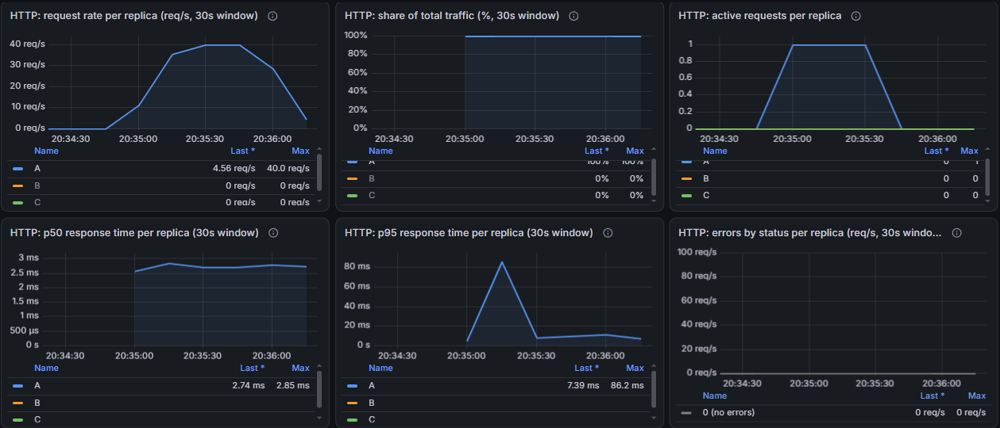{width=100%}

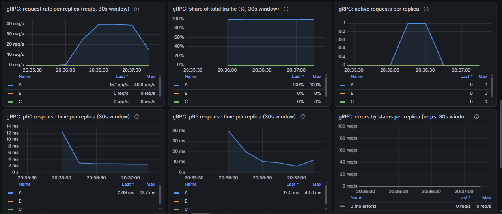{width=100%}

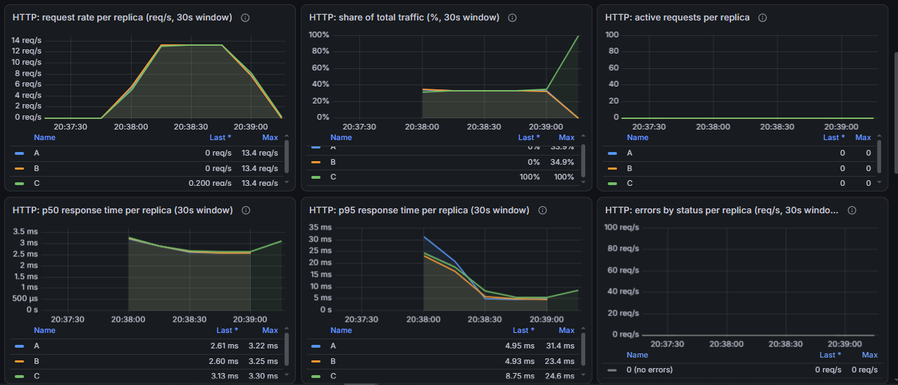{width=100%}

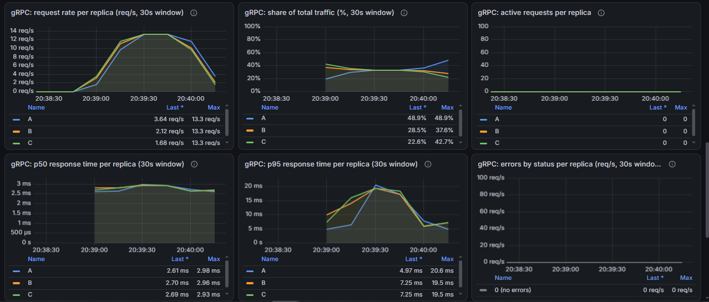{width=100%}

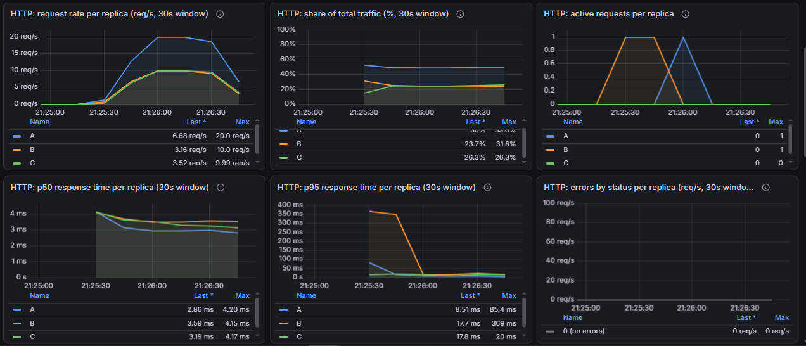{width=100%}

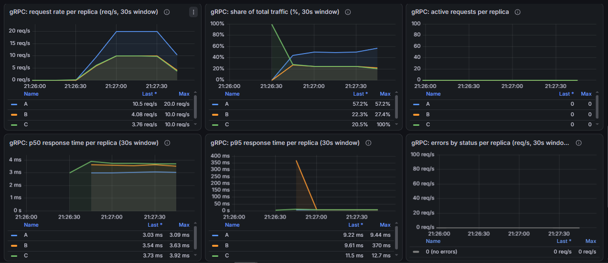{width=100%}

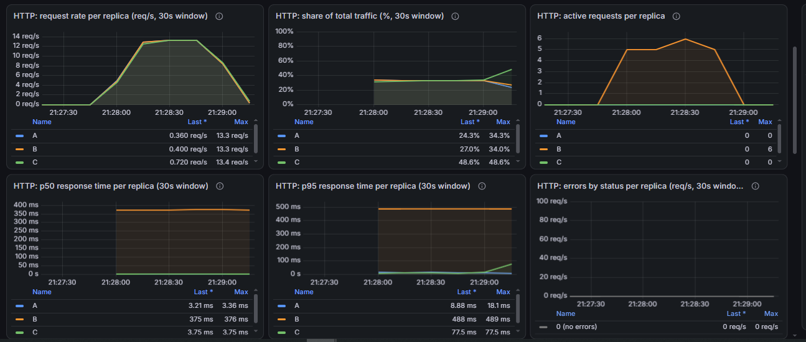{width=100%}

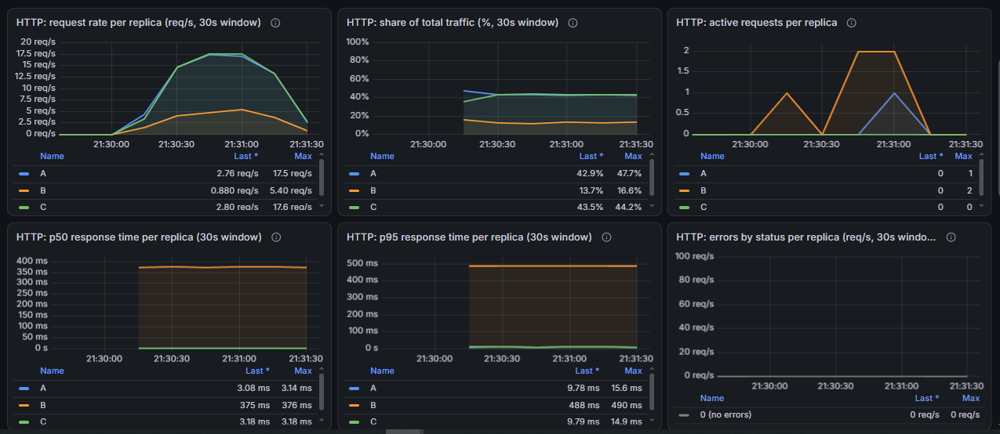{width=100%}

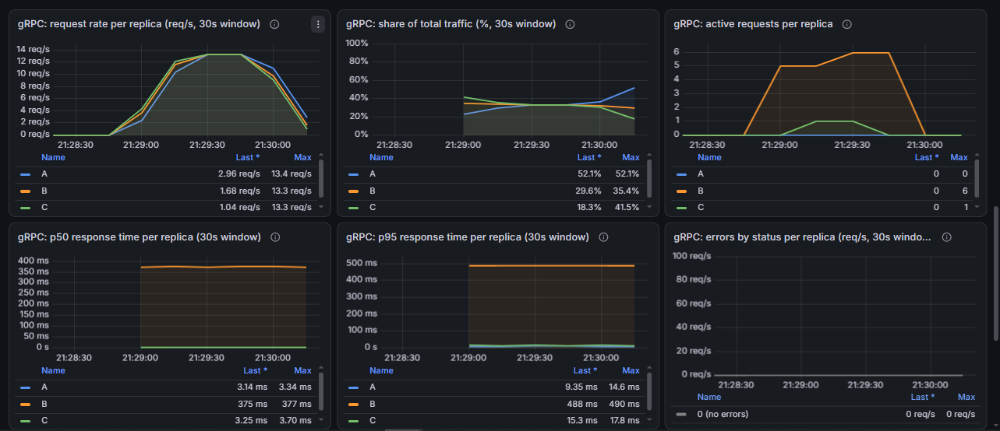{width=100%}

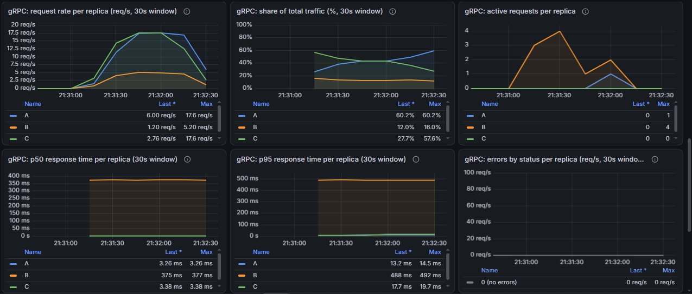{width=100%}

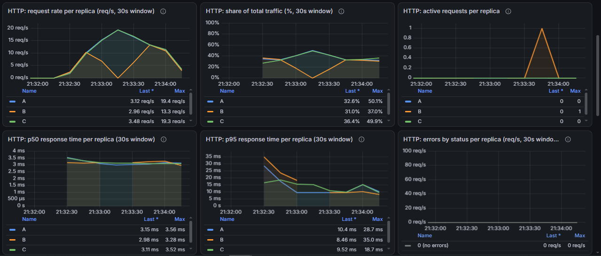{width=100%}

{width=100%}

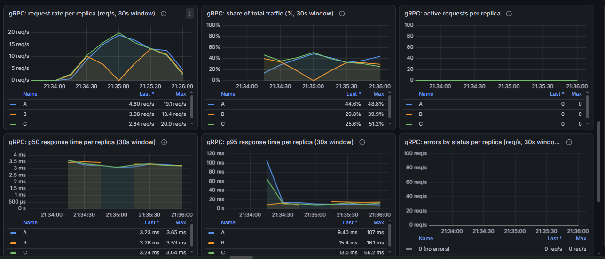{width=100%}

{width=100%}

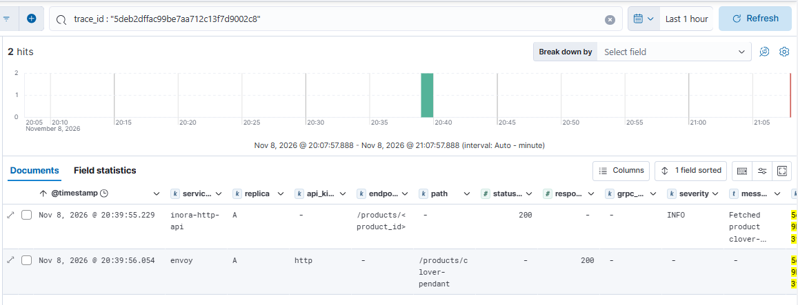{width=100%}

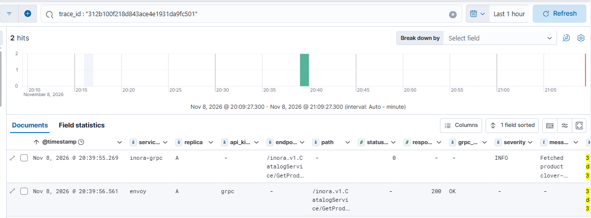{width=100%}

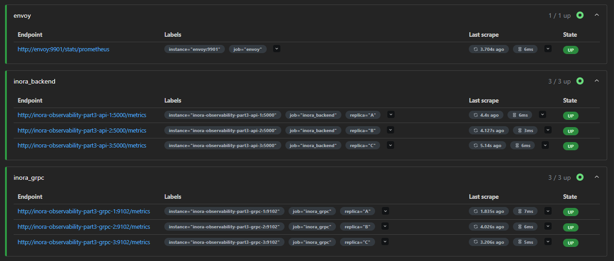{width=100%}

{width=100%}
